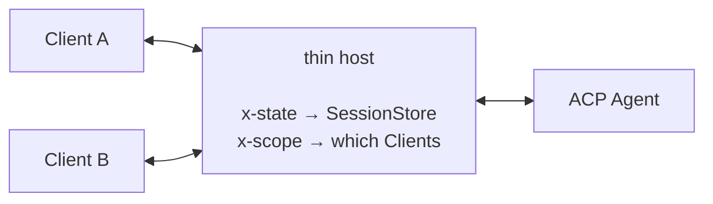
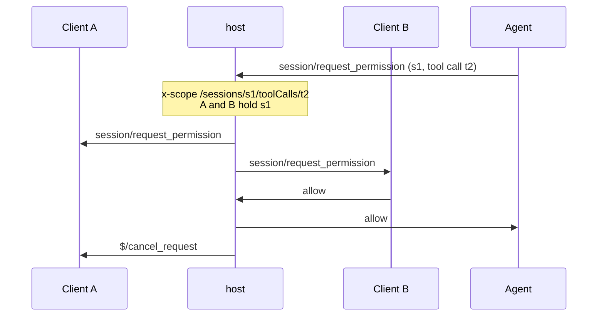

# acp-thin-host

A reference implementation for the RFD **v2 Session State and Message Scope Annotations** (`x-state`, `x-scope`).

The host serves one ACP Agent to several Clients. A second Client can join a live session, and a request from the
Agent reaches the right Client. The host has code for the session lifecycle (`initialize`, `session/new`,
`session/fork`, `session/resume`, `session/close`). How each update and each Agent-to-Client message is stored
and where it goes comes from the annotations, so the host has no code for any of them.



```sh
npm run demo     # Node 22.18 or newer. No install and no network.
npm test
```

## `x-state`: the host keeps the session

Each update is stored by its rule from [`annotations.json`](annotations.json). The store has no code for any variant:

| The Agent sends | Rule | Stored |
|---|---|---|
| `agent_message_chunk` m1 `"Look"` | `append` `/sessions/{sessionId}/messages/agent/{update.messageId}/content` | message m1 with one content block |
| `agent_message_chunk` m1 `"ing…"` | the same | message m1 with two content blocks |
| `tool_call_update` t1 `in_progress` | `upsert` `/sessions/{sessionId}/toolCalls/{update.toolCallId}` | tool call t1, `in_progress` |
| `notice` | `none` | nothing: live only |
| `tool_call_update` t1 `completed` | the same `upsert` | tool call t1, `completed`, title kept |

When Client B joins with `session/resume` and `replayFrom`, the host answers from its store. The Agent is not
asked. Each entity is sent as one update, in the order of first report, then `replay_complete`, then the current
values:

```
   host → B      session/update  user_message {"content":[{"type":"text","text":"Fix the test"}],"messageId":"u1"}
   host → B      session/update  agent_message {"content":[{"type":"text","text":"Look"},{"type":"text","text":"ing…"}],"messageId":"m1"}
   host → B      session/update  tool_call_update {"toolCallId":"t1","title":"Run tests","status":"completed"}
   host → B      session/update  replay_complete {}
   host → B      session/update  config_option_update {"configOptions":[{"id":"model","currentValue":"small"}]}
   host → B      session/update  available_commands_update {"availableCommands":[]}
   host → B      result {"configOptions":[{"id":"model","currentValue":"small"}],"availableCommands":[]}
```

The config options came from the rule on the `session/new` response. No update carried them.

## `x-scope`: the host sends a message to the right Clients

The scope is the first path whose fields are all in the params. The host sends the message to the Clients that hold
that thing:

| The Agent sends | Scope | Who gets it |
|---|---|---|
| `session/update` for s1 | `/sessions/s1` | A and B: both hold s1 |
| `session/request_permission` for tool call t2 | `/sessions/s1/toolCalls/t2` | A and B. The first answer wins, the other Client gets `$/cancel_request` |
| `elicitation/create` with `requestId` 4 | `/requests/4` | only A, which sent request 4. A sees its own ID, 3 |
| `_auth/status_update` (custom, no `sessionId`) | `/`, declared by the Agent in `initialize` | A and B |

Who may receive or answer a message is host policy, not part of the annotation. This host assumes that one user is
behind all Clients.



## Annotations in `initialize`

The host sets `capabilities.schema: {}` in its `initialize` request. The Agent returns the annotations of the
messages it sends, and for each message the host uses the Agent's annotation before its own. In the demo, the
Agent declares its custom method:

```json
"capabilities": { "schema": { "methods": { "_auth/status_update": { "x-scope": ["/"] } } } }
```

A custom update or method may write only a `_` name below `/sessions/{sessionId}/` or directly below `/`, so it
cannot change ACP state. The Agent may also send annotations for ACP messages; the RFD requires them to be the
ones of its schema, and the host uses them as they come. A Client that sets `capabilities.schema: {}` gets the
annotations that the host uses.

## Files

| File | Lines | What it is |
|---|---|---|
| [`annotations.json`](annotations.json) | 57 | Every `x-state` and `x-scope` annotation of ACP v2, in the shape of `capabilities.schema` |
| [`src/state.ts`](src/state.ts) | 153 | `x-state`: one generic function that stores each session, and the replay for a joining Client |
| [`src/scope.ts`](src/scope.ts) | 24 | `x-scope`: what an Agent-to-Client message is about |
| [`src/paths.ts`](src/paths.ts) | 24 | The path grammar of both annotations |
| [`src/annotations.ts`](src/annotations.ts) | 39 | Loads the table and puts the Agent's annotations over it |
| [`src/host.ts`](src/host.ts) | 207 | The host: the session lifecycle and delivery by scope |
| [`src/jsonrpc.ts`](src/jsonrpc.ts), [`src/main.ts`](src/main.ts), [`src/watch.ts`](src/watch.ts) | 139 | JSON-RPC over streams, the command line, and a terminal Client |
| [`check.ts`](check.ts) | 75 | The generator rule of the RFD, run on the ACP schema |
| [`demo.ts`](demo.ts), [`test/`](test) | 357 | The walk-through and 15 tests on a scripted Agent |

## Check the annotations against ACP

```sh
npm run check    # downloads schema.unstable.json of ACP af7218e once, into .cache/
```

It fails when an update variant has no `x-state`, when an Agent-to-Client method has no `x-scope`, when a rule
names a field that the message does not have, or when an `append` rule does not have the `contentEncoding` of its
value. It found the new `cursor_update` variant on ACP main.

## Run with a real Agent

```sh
node src/main.ts serve -- npx -y @agentclientprotocol/claude-agent-acp@0.107.2
node src/main.ts connect      # an ACP Agent on stdio for your editor; connect a second editor the same way
node src/watch.ts             # or: a terminal Client that joins the latest session
```

Checked with claude-agent-acp 0.107.2 over ACP v2: Client B joined a session and got the same config options and
commands from the store as Client A got from `session/new`. The adapter does not declare `_auth/status_update` yet,
so the host does not deliver it and logs `_auth/status_update has no x-scope`. That is the problem the
annotations in `initialize` solve.

## Not covered

The RFD defines data, not host behavior. These choices belong to this host only:

- One user is behind all Clients. Every Client that holds a scope sees a request, and the first answer wins.
- An update variant without a rule is sent live and is not stored. So is a custom path directly below `/`, and
  an entity that no variant can send whole (only an `append` rule writes it).
- A message scoped to a custom path directly below `/` goes to every Client, like `/`.
- Two Clients that resume one session at the same moment can both get the history from the Agent.
- MCP over ACP (`/mcpServers`) is not supported.
- The first Client's `initialize` goes to the Agent, and every Client gets its result.

<details>
<summary>The full output of <code>npm run demo</code></summary>

```
1. A creates a session
  # The host asks the Agent for its annotations with capabilities.schema: {}.
  # x-state of the session/new response stores the config options.

      A → host   initialize {"protocolVersion":2,"info":{"name":"A","version":"1"},"capabilities":{}}
   host → agent  initialize {"protocolVersion":2,"info":{"name":"A","version":"1"},"capabilities":{"schema":{}}}
  agent → host   result {"protocolVersion":2,"info":{"name":"fake","version":"1"},"capabilities":{"session":{},"schema":{"methods":{"…
   host → A      result {"protocolVersion":2,"info":{"name":"fake","version":"1"},"capabilities":{"session":{}}}
      A → host   session/new {"cwd":"/repo","mcpServers":[]}
   host → agent  session/new {"cwd":"/repo","mcpServers":[]}
  agent → host   result {"sessionId":"s1","configOptions":[{"id":"model","currentValue":"small"}],"availableCommands":[]}
   host → A      result {"sessionId":"s1","configOptions":[{"id":"model","currentValue":"small"}],"availableCommands":[]}

2. The Agent works
  # Each update is stored by its x-state rule. The notice has action "none": live only.

  agent → host   session/update  user_message_chunk {"messageId":"u1","content":{"type":"text","text":"Fix the test"}}
   host → A      session/update  user_message_chunk {"messageId":"u1","content":{"type":"text","text":"Fix the test"}}
  agent → host   session/update  agent_message_chunk {"messageId":"m1","content":{"type":"text","text":"Look"}}
   host → A      session/update  agent_message_chunk {"messageId":"m1","content":{"type":"text","text":"Look"}}
  agent → host   session/update  agent_message_chunk {"messageId":"m1","content":{"type":"text","text":"ing…"}}
   host → A      session/update  agent_message_chunk {"messageId":"m1","content":{"type":"text","text":"ing…"}}
  agent → host   session/update  tool_call_update {"toolCallId":"t1","title":"Run tests","status":"in_progress"}
   host → A      session/update  tool_call_update {"toolCallId":"t1","title":"Run tests","status":"in_progress"}
  agent → host   session/update  notice {"severity":"warning","title":"Rate limit soon"}
   host → A      session/update  notice {"severity":"warning","title":"Rate limit soon"}
  agent → host   session/update  tool_call_update {"toolCallId":"t1","status":"completed"}
   host → A      session/update  tool_call_update {"toolCallId":"t1","status":"completed"}

3. B joins the live session
  # The host answers session/resume from its store. The Agent gets nothing.
  # Two chunks are one agent_message, two tool call updates are one, and the notice is gone.

      B → host   initialize {"protocolVersion":2,"info":{"name":"B","version":"1"},"capabilities":{}}
   host → B      result {"protocolVersion":2,"info":{"name":"fake","version":"1"},"capabilities":{"session":{}}}
      B → host   session/list {}
   host → agent  session/list {}
  agent → host   result {"sessions":[{"sessionId":"s1","cwd":"/repo"}]}
   host → B      result {"sessions":[{"sessionId":"s1","cwd":"/repo"}]}
      B → host   session/resume {"sessionId":"s1","cwd":"/repo","mcpServers":[],"replayFrom":{"type":"start"}}
   host → B      session/update  user_message {"content":[{"type":"text","text":"Fix the test"}],"messageId":"u1"}
   host → B      session/update  agent_message {"content":[{"type":"text","text":"Look"},{"type":"text","text":"ing…"}],"messageId":"m1"}
   host → B      session/update  tool_call_update {"toolCallId":"t1","title":"Run tests","status":"completed"}
   host → B      session/update  replay_complete {}
   host → B      session/update  config_option_update {"configOptions":[{"id":"model","currentValue":"small"}]}
   host → B      session/update  available_commands_update {"availableCommands":[]}
   host → B      result {"configOptions":[{"id":"model","currentValue":"small"}],"availableCommands":[]}

4. The Agent asks for permission
  # x-scope: /sessions/s1/toolCalls/t2. Both Clients hold s1, so both see it.
  # Host policy: the first answer wins. B answers, and A gets $/cancel_request.

  agent → host   session/request_permission {"sessionId":"s1","title":"Edit file?","subject":{"type":"tool_call","toolCall":{"toolCallId":"t2","title":"E…
   host → A      session/request_permission {"sessionId":"s1","title":"Edit file?","subject":{"type":"tool_call","toolCall":{"toolCallId":"t2","title":"E…
   host → B      session/request_permission {"sessionId":"s1","title":"Edit file?","subject":{"type":"tool_call","toolCall":{"toolCallId":"t2","title":"E…
      B → host   result {"outcome":{"outcome":"selected","optionId":"allow"}}
   host → agent  result {"outcome":{"outcome":"selected","optionId":"allow"}}
   host → A      $/cancel_request {"requestId":1}

5. A custom notification without a sessionId
  # x-scope "/" comes from the Agent's capabilities.schema: every Client gets it.

  agent → host   _auth/status_update {"status":"signed_in"}
   host → A      _auth/status_update {"status":"signed_in"}
   host → B      _auth/status_update {"status":"signed_in"}

6. An elicitation about one Client request
  # x-scope: /requests/{requestId}. Only A sent that request, so only A gets it.
  # The Agent knows the host's ID of the prompt (4). A gets its own ID back (3).

      A → host   session/prompt {"sessionId":"s1","prompt":[{"type":"text","text":"Which test?"}]}
   host → agent  session/prompt {"sessionId":"s1","prompt":[{"type":"text","text":"Which test?"}]}
  agent → host   elicitation/create {"requestId":4,"mode":"form","message":"Which file?","requestedSchema":{}}
   host → A      elicitation/create {"requestId":3,"mode":"form","message":"Which file?","requestedSchema":{}}
      A → host   result {"action":"cancel"}
   host → agent  result {"action":"cancel"}
  agent → host   result {"stopReason":"end_turn"}
   host → A      result {"stopReason":"end_turn"}
```

</details>
